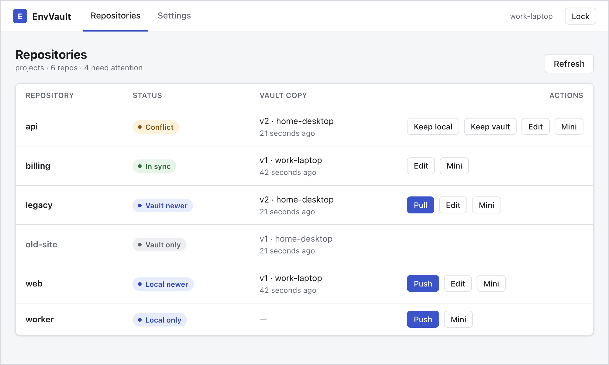
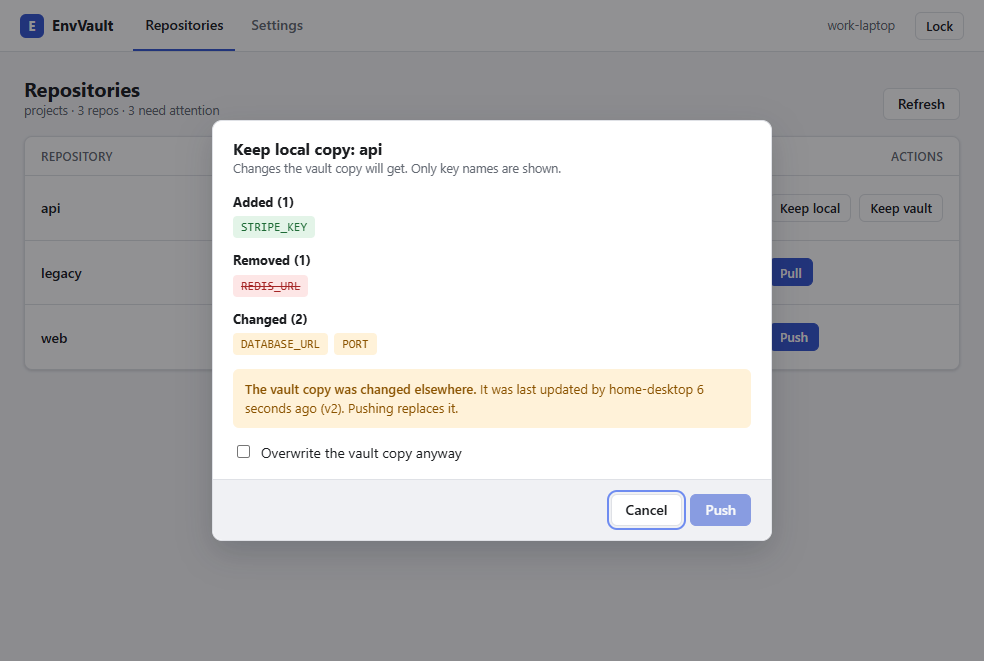
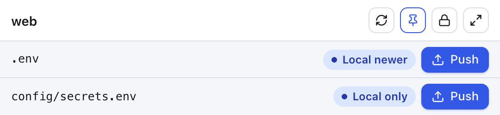

# EnvVault

[](https://github.com/msywensky/envvault/actions/workflows/ci.yml)

A desktop app (Electron + Vue 3 + TypeScript, macOS and Windows) that keeps your projects' `.env` files in sync between your machines (in a monorepo, the one in each package too, and variants such as `.env.local` in the repos you choose), through an **encrypted** vault: a folder synced between them (such as a Google Drive folder), or a private git repository. The sync folder or the git host never sees values or key names, only ciphertext and a little metadata. Plaintext stays in your repos, which EnvVault checks are git-ignored before it writes anything.



## Contents

- [How it works](#how-it-works)
- [Security](#security)
- [Install](#install)
- [Setup](#setup)
- [Using it](#using-it)
  - [Resolving a conflict](#resolving-a-conflict)
  - [Machine-specific keys](#machine-specific-keys)
  - [`.env.example` checks](#envexample-checks)
  - [Monorepos](#monorepos)
  - [Repo settings](#repo-settings)
  - [Editing the vault copy](#editing-the-vault-copy)
  - [Removing a vault copy](#removing-a-vault-copy)
  - [Automatic pull](#automatic-pull)
  - [Mini mode](#mini-mode)
  - [Command line](#command-line)
  - [Claude Code skill](#claude-code-skill)
  - [Recovery](#recovery)
- [Settings](#settings)
- [Development](#development)
- [Roadmap](#roadmap)
- [License](#license)

## How it works

```
Projects folder (each machine)                  Vault folder (synced by Google Drive etc.)
  api/.env               ── push ──▶ encrypt ──▶  api.env.enc
  web/.env               ◀── pull ── decrypt ◀──  web.env.enc
  platform/apps/web/.env ── push ──▶ encrypt ──▶  platform.<tag>.file.enc
                                                  meta.json   (KDF params, salt, key check)
```

The vault can also be a **private git repository** instead of a synced folder: the same files, on one branch, which EnvVault fetches and pushes itself (see [Git vaults](docs/security.md#git-vaults)).

**Sync status** is three-way: local file, vault copy, and what this machine last synced. That separates "local newer", "vault newer" and "conflict". A vault copy whose version went backwards (a rollback) is shown as a conflict, never offered as a simple pull. The one exception is when it is byte-identical to your local file: then nothing would change either way, and it shows as in sync.

| Status      | Meaning                                                                                      | Action   |
| ----------- | -------------------------------------------------------------------------------------------- | -------- |
| In sync     | Local and vault are byte-identical, apart from machine-specific values                       | —        |
| Local only  | Never pushed                                                                                 | Push     |
| Local newer | Only you changed it since the last sync                                                      | Push     |
| Vault newer | Only another machine changed it                                                              | Pull     |
| Conflict    | Both changed, or they differ and this machine never synced them, or the vault went backwards | Resolve… |
| Vault only  | In the vault, but the repo isn't in your projects folder, or the file's folder isn't in it   | Remove…  |
| Excluded    | In the vault, but the repo's settings no longer sync it                                      | Remove…  |
| No .env     | Nothing on either side                                                                       | —        |

Every push and pull shows a confirmation with the **key names** that will be added, removed or changed, never their values. Pushing over a vault copy that someone else changed needs an explicit "overwrite anyway". A pull first saves your current `.env` as `.env.bak.<timestamp>` and keeps the 3 newest backups per file, deleting older ones (change the number or turn backups off in **Settings → Sync**). Backups are plaintext like `.env`. Git ignores them, but other tools don't read `.gitignore`: add `.env.bak.*` to a `.dockerignore` too.

To see exactly what a pull would change, click **Show raw diff** in the pull dialog. It shows a line-by-line diff from your `.env` to the vault copy with every value masked (`KEY=••••••••`); comments are shown as they are. Click **Show values** to see the values; they are hidden again after a minute (see [Env values](docs/security.md#env-values)).



## Security

EnvVault encrypts each `.env` with XChaCha20-Poly1305, under a key derived with Argon2id from your master password and a setup code that each of your machines keeps (on by default, always for a git vault). The sync folder or git host sees only ciphertext, your repo names, how many env files each has (not their paths), file sizes and when they changed. Repo settings are encrypted too, ignored repos' names included. The key never leaves EnvVault's main process and is wiped when it locks, and env values reach the app's window only when you ask to see them. EnvVault doesn't protect against malware running as you while it's unlocked, a weak password without a setup code, or the plaintext `.env` files in your repos. [Security design and threat model](docs/security.md) has the details, including the vault's file format.

## Install

Download the installer from the [latest release](https://github.com/msywensky/envvault/releases/latest): `envvault-<version>-setup.exe` for Windows, `envvault-<version>.dmg` for macOS. Each comes with a `.sha256` file; check the download against it.

These 0.x builds are **not code-signed**, so your OS warns you the first time:

- **Windows:** SmartScreen says "Windows protected your PC". Click **More info**, then **Run anyway**.
- **macOS:** Gatekeeper refuses to open it. Control-click the app, choose **Open** and confirm, or run `xattr -dr com.apple.quarantine /Applications/EnvVault.app`. System notifications don't work in an unsigned app; automatic pulls badge the Dock icon instead.

There's no auto-update: install a newer release over the old one. Or build from source, below.

## Setup

Requirements: Node.js 22 or newer, git, and either a folder synced between your machines (for example `My Drive/EnvVault` in Google Drive for desktop) or a private git repository (git 2.32 or newer). The [GitHub CLI](https://cli.github.com), signed in with `gh auth login`, lets EnvVault create and list GitHub repositories for you; it's optional.

```sh
npm install
npm run dev        # run the app with hot reload
npm test           # unit + integration tests
npm run build      # typecheck and build to out/
```

## Using it

1. **First machine:** choose your projects folder (the folder that contains your git repos) and the vault, then create the vault with a master password of at least 12 characters that isn't easy to guess (several random words, or one your password manager generates). The vault is either:
   - **a synced folder:** pick it with the folder picker;
   - **a private git repository:** **Create a new vault repository** makes a private one on your GitHub account through the GitHub CLI, or, without it, opens GitHub's new-repository page so you can paste its URL. **Select an existing one** lists your private GitHub repositories, and always takes a pasted URL (GitHub, GitLab, a server of your own). Use a repository just for the vault: EnvVault refuses one that holds other files, and one that isn't private. For a server of your own that can't be checked from outside (SSH only, say), EnvVault asks you to confirm that the repository is private, once.
     Creating it also offers **Require a setup code on every machine**, on by default and always on for a git vault. EnvVault then shows the vault's setup code once (`EV-XXXXX-XXXXX-XXXXX-XXXXX-XXXXX-XXXX`): save it in your password manager next to the master password, and type its last group to continue. You can show it again in **Settings → General**, after entering the password.
2. **Other machines:** choose the same vault folder (wait for Drive to finish syncing first) or the same repository, and unlock it with the same password, plus the setup code the first time on each machine. EnvVault won't offer to create a vault where encrypted files already are.
3. Push and pull from the Repositories table. For a conflict, click **Resolve…** to choose a copy for each key that differs (see below).

### Resolving a conflict

A conflict means both copies changed since this machine last synced, or they differ and this machine never synced them. **Resolve…** merges them key by key:

- Every key whose copies differ is listed by name: different values, only on this machine, or only in the vault copy. Choose which copy each one comes from. **Use this machine's for all** and **Use the vault's for all** set every key at once.
- If a key differs because each machine should have its own value (a port, a local path), choose **Machine-specific**: your `.env` keeps your value and gets the [marker](#machine-specific-keys), and the vault copy keeps the key without a value.
- Nothing is chosen for you, with one exception. EnvVault remembers only a hash of what it last synced, not the content, so it can't tell whether a key only one copy has was added there or removed from the other. The exception: if this machine never synced the file and your `.env` only lacks keys the vault copy has (every other key the same), it's most likely just older, so those keys start as **Add**.
- Values are masked. **Show values** shows both copies' values; they are hidden again after a minute.
- **Save** brings both sides in sync. What it writes depends on your choices, and the dialog says so once every key has one:
  - every key from the vault: your `.env` becomes the vault copy (backed up first, like a pull), and the vault copy doesn't change;
  - every key from this machine: your `.env` stays as you wrote it (apart from markers for machine-specific keys) and becomes the new version of the vault copy, like a push;
  - a mix: your `.env` is rewritten (backed up first) and the vault copy gets a new version. Comments and layout come from the vault copy.
- Machine-specific keys keep your values, as on a pull.
- A vault copy that went backwards (a rollback) is never merged, and copies that differ only in formatting or comments have no keys to choose. For those, and for a file that can't be compared, the dialog offers **Keep this machine's file…** and **Keep the vault's file…** instead: a push that overwrites the vault copy, or a pull.

### Machine-specific keys

Some values differ between machines, such as a local path. Put `# envvault:local` on the line directly above such a key:

```sh
API_URL=https://api.example.com
# envvault:local
DATA_DIR=/Users/me/data
```

- A push uploads the key without its value (`DATA_DIR=` under the marker), so the value never leaves this machine, and changing it doesn't make the repo "local newer".
- A pull never overwrites or deletes a key that is marked in your `.env` or in the vault copy. It keeps your line and adds the marker if your file didn't have it. A marked key you don't have yet is written empty, and the pull dialog lists it so you can fill it in.
- If the vault marks a key but your `.env` doesn't, pushing uploads your value and drops the marker. The push dialog warns you first.
- A marked key must be assigned only once in the file.

You can also mark a key from the app: **Machine-specific** in the [Resolve dialog](#resolving-a-conflict) or in the [editor](#editing-the-vault-copy), or, when a pull would change a key's value, **Should any of these differ on each machine?** in the pull dialog (the button becomes **Pull and mark**). Either way the vault copy keeps the key without its value, and each machine adds the marker the next time it pulls, keeping its own value. Pull and mark writes a new version of the vault copy as well as your `.env`.

To make a key shared again, remove its `# envvault:local` line in the `.env` on each machine, then push. Removing it in only one place isn't enough: a pull keeps a key that your `.env` marks, and the next push from that machine marks it in the vault again.

### `.env.example` checks

If a repo has a `.env.example`, the push and pull dialogs compare it with the `.env` you'll end up with (your file on push, the pulled result on pull). They warn, but never block, about:

- keys `.env.example` lists that your `.env` doesn't have. Keys commented out in the example count as optional;
- keys your `.env` has that `.env.example` doesn't document;
- values that are the same in both files and look like secrets, since `.env.example` is usually committed. A value looks like a secret if it is a URL with a password for a non-local host, 8+ characters under a key name such as `*_SECRET`, `*_TOKEN`, `*_PASSWORD` or `*_KEY`, or a long token-like string. Localhost URLs, ports, other plain values and browser-public keys (`VITE_`, `NEXT_PUBLIC_`, ...) are never flagged.

You can turn the checks off in **Settings → Sync**.

### Monorepos

Besides each repo's root `.env`, EnvVault syncs the `.env` in any of its folders: `apps/web/.env`, `packages/db/.env`, `supabase/functions/.env`. Variants such as `.env.local` sync too in the repos whose [settings](#repo-settings) include them.

- **Found with git.** EnvVault asks git (`git ls-files`) for every env file it knows of in each repo: ignored ones, and also ones git would commit, or a committed `.env`, so you're told before a pull. Folders git ignores, such as `node_modules` or build output, are never searched. This runs when the Repositories list opens and when you click **Refresh**; automatic pull and mini mode use what it found then.
- **Listed under their repo.** A repo with only a root `.env` is one row. Otherwise its name is followed by a row per file. Files found in folders that nobody has pushed yet are listed apart, under _N .env files found in folders, not in the vault yet_, collapsed, each with a **Push** button; they don't count as needing attention.
- **On your other machines,** a pushed file appears as Vault newer and is pulled like any other. A pull never creates a folder: if `apps/web` isn't in that machine's copy of the repo (another branch, a renamed package), the file shows as Vault only.
- **Next to the file.** A file's backups, its `.env.example` check and its git checks are all in its own folder. **Add to .gitignore** adds the lines to the repo's root `.gitignore`, where they cover every folder.
- **Symlinks:** a `.env` under a symlinked folder is refused. A symlinked `.env` that isn't in the vault (a shared root `.env` linked into a package, say) is skipped.
- **In the vault,** such a file is `<repo>.<tag>.file.enc`. The tag is a keyed hash of its path, so the sync folder or git host can see how many `.env` files a repo has, but not their paths. Hover over a row to see the name its vault copy has, for finding it in Drive's version history or the repository's.

### Repo settings

Click **Settings…** on a repo (on its row, or next to its name when it has several files) to choose what EnvVault does with it. Everything except **Sync as** is kept in the vault, encrypted, so every machine uses the same settings.

- **Env files to sync** and **Env files not to sync** are patterns, one per line. By default every repo syncs each `.env`, in any folder. **Defaults…**, above the list, opens **Settings → Sync**, where you change that for every repo without lists of its own.
  - A name matches in every folder: `.env.local`, `.env.*`, `.env.*.local`. A path is from the repo root: `apps/*/.env.local`. A path whose last part isn't a file name means a folder and everything in it: `apps/legacy`, `**/fixtures`. `*` matches within a name, `**` any number of folders, and case doesn't matter.
  - Exclude wins. A Next.js or Vite app that commits `.env` with its defaults and keeps its secrets in `.env.local` syncs `.env.local` only: include `.env.local`.
  - Never synced, whatever the patterns say: templates (`.env.example`, `.env.sample`, `.env.template`, `.env.dist`, `.env.defaults`, also after another name, as in `.env.local.example`) and EnvVault's own backups (`.env.bak.*`). Variants git tracks, such as a committed `.env.development`, aren't listed either: git already syncs them.
  - Variants such as `.env.local` often hold values that differ between machines. Sync them only where they don't, or mark those keys [machine-specific](#machine-specific-keys).
  - The dialog shows which files the patterns match, from what git found at the last Refresh. Changes apply at once.
  - A vault copy the patterns no longer include stays in the vault, listed as **Excluded** with **Remove…**. It's never pushed, pulled or edited.
  - A variant's backups are named after it (`.env.bak.local.<timestamp>`) and kept apart from the `.env`'s. Its `.env.example` check is skipped. **Add to .gitignore** adds the file's own name.
- **Ignore this repo:** EnvVault doesn't read its files, push them or pull into it, on any machine, and the command line refuses it. It moves to the collapsed **Ignored** list under the table, with **Stop ignoring**. Its vault copies stay.
- **Sync as** (this machine only) is the name the folder's files have in the vault. Use it for a second checkout or a git worktree of a repo (`api-wt` syncing as `api`), or a folder you renamed. Each folder keeps its own sync status, so a push from one shows the other as Vault newer.

Repos with no env files on either side are listed apart too, under **No env files**, with **Edit** (to start a vault copy), **Ignore** and **Settings…**.

If the settings in the vault fail verification, EnvVault uses the built-in ones (every `.env` syncs, no repo is ignored) and offers **Reset settings…**. Settings saved by a newer EnvVault are left alone until you update this one.

### Editing the vault copy

Click **Edit** on a `.env` to change its vault copy in a table of keys and values, without a local `.env`. On a repo with no `.env` and no vault copy, this creates one.

- Values are masked until you click **Show**, and masked again when the window is hidden or after a minute without input. You can type or paste a new value into a masked field without displaying it. Multi-line values (such as a PEM key) need **Show** to edit.
- You can add, change and remove keys. Machine-specific keys are listed but have no value to edit, since the vault doesn't store one.
- **Machine-specific** marks a key: the vault copy keeps it without its value, and each machine keeps its own (see [Machine-specific keys](#machine-specific-keys)).
- Comments, blank lines, `export`, spacing and line endings stay as they are. A changed value keeps its line's prefix and trailing comment, and is quoted only as much as dotenv needs to read it back exactly.
- **Review changes** lists the key names that change. **Save to vault** writes a new version, unless the vault copy changed since you opened the editor; then reload and edit again.
- Saving never touches your local `.env` directly. A repo that has one shows "Vault newer" afterwards; automatic pull brings the edit in right away (or click **Pull** if it's off), keeping machine-specific values.

### Removing a vault copy

Click **Remove…** on a Vault only row (a repo or package that's gone), or **Remove from vault…** in the editor, to delete a file's vault copy.

- It asks first, and deletes only the copy it showed you: if another machine changed it meanwhile, nothing is removed.
- No `.env` is changed or deleted, on this machine or any other. A machine that still has the file shows it as never pushed and can push it again, which continues its version numbers.
- A git vault keeps old copies in its history, and Drive keeps deleted files in its trash for a while.
- A vault copy that can't be read is listed as _Unreadable vault copy_, with its name in the vault. It can't be removed from the app; delete that file from the vault folder or repository by hand.

### Automatic pull

Off by default; turn it on in **Settings → Sync**. While EnvVault is unlocked, it checks every minute (and right after you unlock or save an edit) for `.env` files whose vault copy changed on another machine while your file didn't, and pulls them for you. You get a toast, and if EnvVault isn't the focused window, a system notification. macOS shows notifications only for code-signed apps, so unsigned builds (including dev runs) badge the Dock icon with the number of pulls and bounce it once instead; the badge clears when you switch to EnvVault. On Windows the taskbar button flashes if a notification can't be shown.

- It never pulls a conflict, a rollback, or a `.env` that isn't git-ignored or is tracked; those keep their **Pull** button. Nor one whose folder isn't there.
- It creates a missing `.env` when the vault has a copy, including one you deleted.
- It saves a backup first if backups are on, like a manual pull. A running dev server that watches `.env` may restart when the file changes.
- It stops when EnvVault locks; it doesn't keep the vault unlocked.
- It's off by default because a push from any of your machines, or from anything allowed to push, then changes this machine's `.env` files without you reviewing it. A `.env` is configuration as well as secrets: a changed URL can send credentials elsewhere, and variables like `NODE_OPTIONS` can run code in whatever loads the file.

### Mini mode

Click **Mini** next to a `.env` to shrink EnvVault to a small window, two rows tall, kept above your other windows: that file's **Push** (or **Pull**) button next to the window's controls, and its status below. Hover over the status for the vault copy's version. Click **Full view** to go back.



- The status updates when that `.env` changes, when you switch to the window, and every minute. These checks don't count as activity, so they don't keep the vault unlocked.
- **Push** still shows the review first: the window grows for it, then shrinks back.
- A conflict shows **Resolve…**, which goes back to the full window and opens the Resolve dialog there.
- When EnvVault locks, the mini window asks for the master password. A machine that still needs the setup code unlocks in the full window.
- **On top** turns keeping it above other windows on or off. It's the same setting as _Keep the mini window on top_ in **Settings → General**.

### Command line

Turn on **Allow command-line access** in **Settings → Command line**. Then, while EnvVault is running and unlocked, run `envvault` inside a repo in your projects folder:

```sh
envvault status                  # the status of this repo's .env files (--all for every repo)
envvault push                    # shows the key changes, asks, then pushes
envvault push --dry-run          # only shows them, with a token...
envvault push --expect <token>   # ...that pushes exactly what you saw, if nothing changed since
```

- `push` uses the env file the repo syncs in the current folder, or in the nearest one above it in the repo, or else the repo's root `.env`. In a monorepo, run it in the package's folder. A folder with several (`.env` and `.env.local`) means its `.env`; with several and no `.env`, pass `--path`.
- `status` also names the repos you've told EnvVault to ignore, and `push` refuses them.
- Run `npm link` in this repo once to put `envvault` on your PATH, or run `node out/cli/envvault.mjs`. `npm run build` builds it. In a packaged app it's in `app.asar.unpacked/out/cli/`, and needs Node 22 or newer.
- It shows key names only, never values.
- It pushes only one-sided changes. If the vault copy changed on another machine, it tells you to resolve it in the app.
- Options:
  - `--repo <name>` picks a repo by name instead of the current folder;
  - `--path <path>`, with `push`, picks an env file by its path from the repo root, such as `apps/web/.env` or `.env.local`;
  - `--json` prints JSON;
  - `--yes` pushes without asking.
- Exit codes:
  - 0: done;
  - 1: refused or failed;
  - 2: usage;
  - 3: locked;
  - 4: EnvVault isn't running, or command-line access is off.
- It doesn't count as activity, so EnvVault still auto-locks (if auto-lock is on); unlock it in the app.
- There's no pull command: automatic pull covers it.

### Claude Code skill

With command-line access on, click **Install** next to _Claude Code skill_ in **Settings → Command line**. That writes `~/.claude/skills/envvault/SKILL.md`, so in any project you can ask Claude to check or push the repo's `.env` files, or type `/envvault`.

- Claude runs `status` and `push --dry-run` on its own, shows you the key changes and warnings, and asks before the real push. Claude Code also asks you to approve that command.
- The skill points at this copy of EnvVault's command. If you move or update EnvVault, Settings shows it as out of date: click **Update**.
- The skill tells Claude never to read `.env` files. To enforce that for Claude's file tools, add `Read(**/.env)` and `Read(**/.env.bak.*)` to the `deny` list of your Claude Code permissions.
- If Claude Code runs commands in its sandbox and the command reports that EnvVault isn't reachable, allow EnvVault's socket in the sandbox settings, or let the command run outside the sandbox.

### Recovery

There is no backdoor. If you lose the master password, or the setup code and every machine that has it, the vault can't be opened. Your repos' plaintext `.env` files are your remaining copies, so you could start a new vault and push them again.

## Settings

Settings has three tabs. Each has its own **Save**, at its top and bottom, which saves only that tab; a dot on a tab means it has unsaved changes. The projects folder, the vault, the setup code and the Claude Code skill act at once, without **Save**.

| Tab          | Setting             | Default   | Notes                                                                      |
| ------------ | ------------------- | --------- | -------------------------------------------------------------------------- |
| General      | Machine name        | hostname  | Shown to other machines as "updated by"                                    |
| General      | Projects folder     | —         | Repos are its direct subfolders that contain `.git`                        |
| General      | Mini window on top  | On        | Keeps the mini window above other windows                                  |
| General      | Vault               | —         | A synced folder or a private git repository. Changing it locks EnvVault    |
| General      | Setup code          | —         | Shows this machine's setup code for the vault, after the password          |
| General      | Auto-lock           | On, 5 min | 1–120 minutes of inactivity. Turning it off asks you to confirm first      |
| Sync         | Default env files   | `.env`    | Kept in the vault, for every machine (see [Repo settings](#repo-settings)) |
| Sync         | .env.example checks | On        | Warnings in the push and pull dialogs                                      |
| Sync         | Automatic pull      | Off       | Every minute while unlocked; one-sided changes only                        |
| Sync         | Backups             | On, 3     | `.env.bak.<timestamp>` before a pull; keeps the newest 1–50 per file       |
| Command line | Command-line access | Off       | The `envvault` command                                                     |
| Command line | Claude Code skill   | —         | Installs or removes the skill; needs command-line access                   |

Repo settings (**Settings…** on a repo, and the defaults in **Settings → Sync**) are kept in the vault, for every machine; only **Sync as** is this machine's. Settings are stored in Electron's `userData` folder (`config.json`). The per-machine sync state, which holds no secrets, is stored next to it in `state.json`. While command-line access is on, its socket (`cli.sock`, macOS) and token (`cli-token`) are there too, a git vault's mirror is in `git-vaults/`, and vault secrets (sealed) are in `vault-secrets.json`.

## Development

```
src/
  core/      pure, unit-tested logic: crypto, .env diff, sync status, path safety
  main/      Electron main process: window, IPC, session, vault, repos, git, sync
  preload/   contextBridge API (sandboxed, bundled)
  shared/    channel names and types shared by all of them
  renderer/  Vue 3 UI
  cli/       the envvault command (plain Node; talks to the app over a socket)
tests/       Vitest: unit tests for core/, integration tests for main/
```

- `npm run lint`, `npm run typecheck` and `npm test` run in CI on macOS and Windows.
- `tests/sync.test.ts` exercises the real push/pull flows with real git and real crypto in temp folders, simulating two machines, over a vault folder and over a local git repository.
- To test without touching your real settings, run `npm run dev:profile -- [name]` (default name `test`). Each profile keeps its own settings and sync state in `envvault-<name>` next to the real data folder, and profiles can run side by side, so two of them can act as two "machines" on one computer. Add `--reset` to start the profile from scratch. A profile doesn't isolate the folders you pick in it, so choose a scratch vault folder and projects folder. Under the hood this sets `ENVVAULT_PROFILE=<name>`, which works only in unpackaged runs.

## Roadmap

- Resolve conflicts knowing which machine changed each key (a three-way merge), so one-sided changes are chosen for you.
- Automatic pull on or off per repo, and Sync as offered for git worktrees.
- Unlock with the Bitwarden CLI.
- Run a command with the vault copy's values in its environment, without a `.env`.
- Change the master password.

## License

[MIT](LICENSE)
